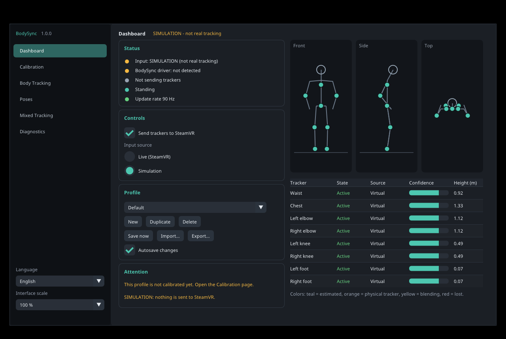
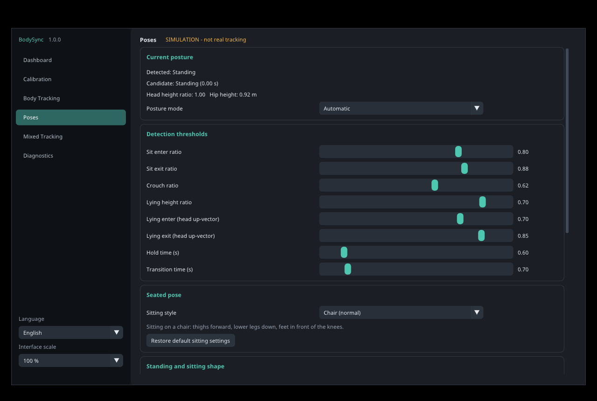

# BodySync

[](https://github.com/BlueHare123/BodySync/releases/tag/v1.0.0)
[](#quick-start)
[](LICENSE)

**EN** · [RU](#русский)

BodySync adds **eight virtual full-body trackers** to SteamVR — waist, chest, both elbows, both knees and both feet. They are estimated from your headset and the two controllers, and physical trackers can be mixed in per role: a healthy tracker takes over, and if it is lost BodySync blends back to the estimate.



## Features

- **Body solver** for standing, sitting and lying, with automatic posture detection, hysteresis, hold times and smooth transitions.
- **Lying** is detected on beds and sofas, with a pillow, in all four lying directions (back, front, left and right side).
- **Squats** move the hips back and lean the torso; the knees respect their limit and the feet stay on the floor.
- **Sitting style** — choose chair, upright torso, leaning back, or cross-legged on the floor.
- **Feet** — planting, stepping, turning in place, walking in place and ground contact.
- **Mixed tracking** — assign physical trackers to roles, with priorities, loss and freeze detection, and smooth hand-over.
- **Calibration wizard** (quick and advanced), manual proportions and offsets, presets.
- **Profiles** with import, export and autosave; damaged files are kept and defaults are loaded.
- **Five interface languages:** English, Русский, Deutsch, Français, Español. Adjustable interface scale.
- **Simulation mode** to check the solver and the pipeline without a headset. Simulated poses never reach SteamVR unless you allow it on the Diagnostics page.

## Components

| Part | File | Job |
|---|---|---|
| Application | `BodySync.exe` | Reads the headset, controllers and trackers through the OpenVR client API, solves the body pose, shows the interface and sends the result to the driver. |
| SteamVR driver | `driver\bodysync\` (`driver_bodysync.dll`) | Registers eight `GenericTracker` devices in SteamVR and publishes the poses it receives over a local named pipe. |
| Helper | `bodysync_setup.exe` | Registers or unregisters the driver folder with SteamVR. |

## Quick start

1. Install with **`BodySync-Setup.exe`** (no administrator rights needed), or unpack **`BodySync-Windows-x64.zip`** into a permanent folder and run `Install.bat`.
2. Start SteamVR once, then start BodySync.
3. Open **Calibration** and run the quick calibration.
4. In SteamVR, open *Manage Trackers* and check that the eight BodySync trackers have the roles waist, chest, elbows, knees and feet.

Guides: [INSTALL](docs/INSTALL.md) · [CALIBRATION](docs/CALIBRATION.md) · [CONFIGURATION](docs/CONFIGURATION.md) · [TROUBLESHOOTING](docs/TROUBLESHOOTING.md) · [BUILD](BUILD.md) · [CHANGELOG](CHANGELOG.md) · [RELEASE NOTES](RELEASE_NOTES.md) · [LICENSES](LICENSES.md)

## Status

Version **1.0.0**. Checked in SteamVR by the author. The automated suite covers the solver, mixer, calibration maths, configuration storage, the named-pipe protocol, the driver (loaded into a mock SteamVR host), the setup helper, the installer and the interface in all five languages. See [RELEASE NOTES](RELEASE_NOTES.md) for details.



## Build

```bash
scripts/build.sh --package    # Linux: cross-builds the Windows x64 release, runs all tests, writes the archives
```

See [BUILD](BUILD.md) for requirements and the manual steps.

---

## Русский

BodySync добавляет в SteamVR **восемь виртуальных трекеров тела** — таз, грудь, оба локтя, оба колена и обе стопы. Они рассчитываются по шлему и двум контроллерам, а физические трекеры можно подмешивать по ролям: пока трекер исправен, он главный; при потере BodySync плавно возвращается к расчёту.

## Возможности

- **Расчёт позы** стоя, сидя и лёжа: автоматическое определение, гистерезис, время удержания и плавные переходы.
- **Лёжа** определяется на кровати и диване, в том числе с подушкой, во всех четырёх положениях (на спине, на животе, на левом и правом боку).
- **Приседание** — таз уходит назад, корпус наклоняется, колени в пределах сгибания, стопы стоят на полу.
- **Стиль сидения** — стул, прямо, откинувшись назад, на полу со скрещёнными ногами.
- **Стопы** — постановка, шаги, поворот на месте, ходьба на месте, контакт с полом.
- **Смешанное отслеживание** — назначение физических трекеров ролям, приоритеты, обнаружение потери и «замерзания», плавная передача.
- **Мастер калибровки** (быстрая и расширенная), ручная настройка пропорций и смещений, пресеты.
- **Профили** с импортом, экспортом и автосохранением; повреждённые файлы сохраняются, загружаются значения по умолчанию.
- **Пять языков интерфейса:** English, Русский, Deutsch, Français, Español; масштаб интерфейса.
- **Режим симуляции** для проверки без шлема. Симулированные позы не уходят в SteamVR, пока вы сами не разрешите это на странице «Диагностика».

## Состав

| Часть | Файл | Назначение |
|---|---|---|
| Приложение | `BodySync.exe` | Читает шлем, контроллеры и трекеры через клиентский API OpenVR, рассчитывает позу, показывает интерфейс и передаёт результат драйверу. |
| Драйвер SteamVR | `driver\bodysync\` (`driver_bodysync.dll`) | Регистрирует восемь `GenericTracker` в SteamVR и публикует позы, полученные по локальному именованному каналу. |
| Помощник | `bodysync_setup.exe` | Регистрирует и снимает с регистрации папку драйвера в SteamVR. |

## Быстрый старт

1. Установите **`BodySync-Setup.exe`** (права администратора не нужны) или распакуйте **`BodySync-Windows-x64.zip`** в постоянную папку и запустите `Install.bat`.
2. Запустите SteamVR, затем BodySync.
3. На странице **«Калибровка»** выполните быструю калибровку.
4. В SteamVR откройте «Управление трекерами» и проверьте, что восемь трекеров BodySync получили роли: таз, грудь, локти, колени, стопы.

Подробнее: [INSTALL](docs/INSTALL.md) · [CALIBRATION](docs/CALIBRATION.md) · [CONFIGURATION](docs/CONFIGURATION.md) · [TROUBLESHOOTING](docs/TROUBLESHOOTING.md) · [BUILD](BUILD.md) · [CHANGELOG](CHANGELOG.md) · [RELEASE NOTES](RELEASE_NOTES.md) · [LICENSES](LICENSES.md)

## Статус

Версия **1.0.0**. Проверено автором в SteamVR. Автоматические тесты охватывают решатель, смеситель, математику калибровки, хранение настроек, канал драйвера, драйвер (загружается в имитацию SteamVR), помощник установки, установщик и интерфейс на всех пяти языках. Подробности — в [RELEASE NOTES](RELEASE_NOTES.md).
